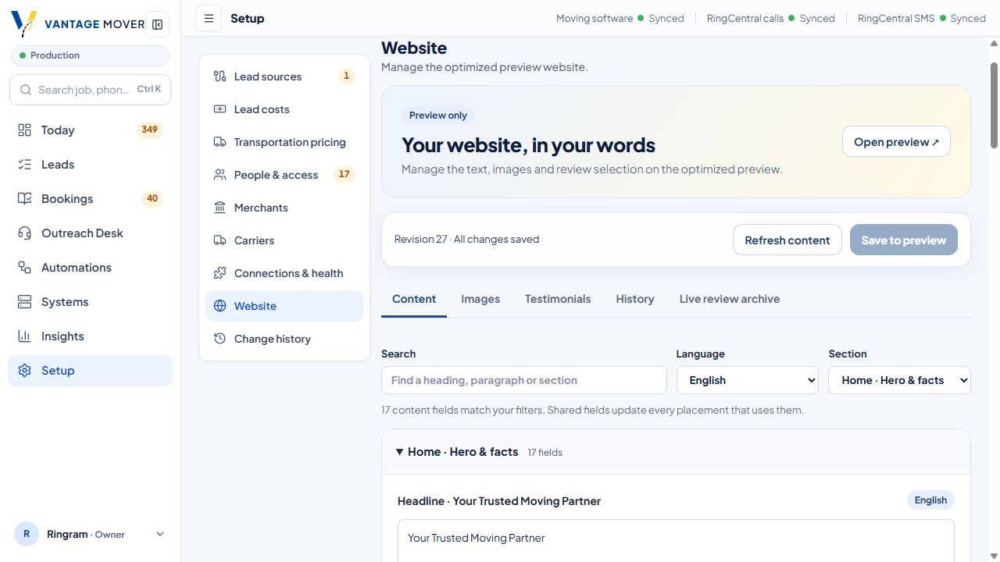
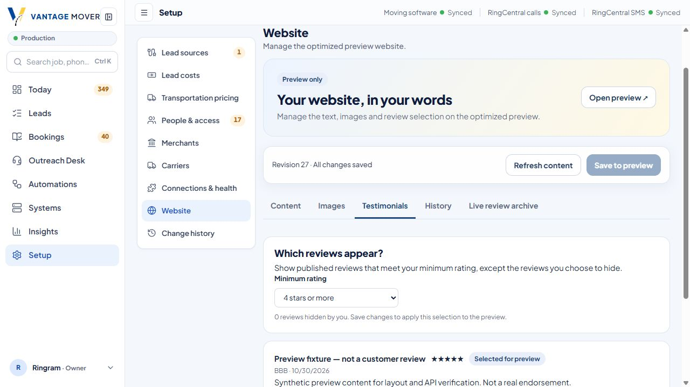

# Owner content controls for the optimization preview

Owner goal, November 12, 2026: identify the preview's exact words and images, then let the Owner edit them and choose eligible testimonials from Vantage Admin. The current live Main Site must keep serving its existing source and content.

## Choice

Use a small content module in the existing platform. The site already owns its layouts, bilingual editorial registry and publication rules; Admin already owns the authenticated Owner experience; the isolated preview API already owns the preview database. An external CMS would add another account, permission system and publishing integration without solving an unmet requirement in this scope.

The API owns a registered content catalog, text/image overrides, testimonial selection policy, revisions and uploaded media. Mongo stores the catalog and versioned overrides. GridFS stores bounded uploaded PNG/JPEG/WebP files separately from the content documents. Existing bundled images remain exact defaults and can be reused across placements. This avoids provisioning another storage vendor for the preview; the media API keeps storage behind one boundary if blob storage becomes useful later.

## Owner workflow

Admin → Setup → Website provides Content, Images, Testimonials and History. Search and language/section filters locate the original content. Save to preview applies edits; Reset to original removes an override. Images can be selected from the registered library or uploaded. The default testimonial condition is four stars or more, with individual exclusions; unpublished testimonials remain excluded. The existing live testimonial archive remains separately labeled and read-only.

History restore creates another revision rather than erasing history. Every mutation requires a current Owner session and signed server-to-server identity; stale revisions are refused. Component variations are labeled Coming soon.

## Preview boundary

- Website source stays on `agent/main-site-optimization`; no promotion to Main Site `main` or production artifact reuse.
- The new API is mounted only in the isolated `agent/site-preview-api` entrypoint and asserts `testvantagemovers_sitepreview` before database access.
- The dashboard's dedicated proxy has a fixed isolated API origin and separate secrets. Browser-supplied origins or actors cannot select another environment.
- Site content reads occur only in explicit Preview mode. Production and partner testimonial behavior remain separate.
- Editorial approval and publication rules, quote capture, Source Company attribution, CRM/messaging isolation and Call Lead qualification are unchanged.

## Inventory and admission

[Exact copy and image inventory](INVENTORY.md) records 56 English/Spanish page routes, original source text, image placements and display attributes. The manifest registers 2,161 descriptors; Admin offers 2,126 copy fields and 31 image placements across 40 website groups. Four immutable historical keyboard constants are inventory-only, explicitly hidden from editing. Metadata-only source fields, layout, publication status and customer-authored review wording remain outside copy editing.

The initial 2,150 descriptors were installed once. The final 11 navigation labels were admitted through the explicit append-only installer at revision 15; replay reported zero appended fields and left revision 15 unchanged. Manifest SHA256: `707061fc9db45d19e4be1839b8b1356ca83ee2ee10e5107184c7d234edc3353e`. Append preserves all original descriptors, overrides and testimonial policy atomically. Later operator additions must use the same guarded command, never reset the content collection.

## Verification record

The isolated Mongo proof covers exact catalog replay, persistent edits, stale/concurrent writes, uploaded image byte parity, reusable catalog images, rating/exclusion/published selection, and revision restore. Source: server `ops/site-preview/cms.replica.ts`; evidence: server `docs/site-preview-cms/evidence/loopback-proof.json`.

The isolated API's final source `315f36c971bca518347fe8acf0f0a6f49642bbeb` passed [preview deployment CI](https://github.com/jbell-rusty-vantage/vantage-movers-server/actions/runs/43339897661) and [full Quality CI](https://github.com/jbell-rusty-vantage/vantage-movers-server/actions/runs/43339905096). [Deployed API proof](evidence/deployed-api.json) verifies API authentication, signed Owner access, durable changes, stale-write rejection, raster upload/bytes, testimonial exclusion and restoration.

Main Site source `f93e5b7` passed lint, typecheck, tests and build in [preview CI](https://github.com/jbell-rusty-vantage/vantage-movers-clients/actions/runs/43340539376). A transient Turbopack Google-font error in unchanged code failed the first build attempt; retry passed without font or dependency changes. The qualified artifact is `https://vantage-movers-clients-main-site-lfohjsb75-vantage-4d3db9ef.vercel.app`, now assigned to the stable optimization-preview alias.

[Baseline parity](evidence/baseline-parity.json) verifies all 56 pages retain their copy and original image references. Existing quote forms are now server-rendered because the preview content read makes the pages dynamic. The comparison removes only their exact known first-step text; the homepage may additionally stream existing blocks in a different raw-HTML order, for which the exact text-token multiset is preserved. [Browser proof](evidence/quote-hydration.json) confirms two existing homepage forms, one Spanish form and one resource form, with no hydration errors.

[Deployed rendering proof](evidence/deployed-rendering.json) temporarily overrides English/Spanish heroes, navigation, numeric copy, template copy, quote labels, legal/resource headings, contact phone/email and a newly uploaded hero image. It checks rendered text outside script payloads, same-origin media byte parity, placement/locale isolation, synchronized contact links and exclusion from both testimonial placements, then restores the original values and policy. [Stable preview proof](evidence/stable-preview.json) confirms the stable alias serves original content with `noindex, nofollow`.

[Deployed Owner proxy proof](evidence/deployed-admin-preview.json) passes anonymous/CSRF rejection, real Owner login, signed catalog access, save/conflict/restore, protected original thumbnails and testimonial eligibility on final Admin preview source. [Browser upload proof](evidence/browser-upload.json) verifies Save and Refresh are disabled during upload, the uploaded image loads, Save persists it and Reset + Save restores the bundled original. The separate delayed/failing-upload Playwright regression is retained but was not executed; do not count it as browser evidence.

Admin [PR 9](https://github.com/jbell-rusty-vantage/vantage-admin/pull/9) is merged at `bd1c6a6b7c5eaaea7e1aee78be044eff3754238b`. Its final [preview CI](https://github.com/jbell-rusty-vantage/vantage-admin/actions/runs/43341660500) passed. A deployed check caught pull-request artifacts marked `HEAD` missing branch-specific runtime credentials; explicitly setting `githubCommitRef` in the deploy command fixed it and the actual Owner proxy proof passed afterward. Production Admin uses its own explicitly configured dedicated preview settings.

All test changes are confined to the isolated preview; no Lead submissions or customer communications are part of these checks. Final dashboard production identity and Main Site preservation are recorded in the release evidence below.

## Released and qualified

The Owner controls are live at [Admin → Setup → Website](https://vantage-admin-rho.vercel.app/setup/website), following successful [production CI](https://github.com/jbell-rusty-vantage/vantage-admin/actions/runs/43342077809). [Production Owner-session proof](evidence/deployed-admin.json) passes read/save/conflict/restore, image thumbnail access, testimonial eligibility and authentication/CSRF enforcement. Browser inspection confirms the live editor, original hero copy, minimum four-star rule and zero exclusions. The upload/reset proof and all temporary text/review edits were restored; final observed revision is 27.

[Final deployment identities](evidence/final-deployments.json), compared with [baseline](evidence/baseline-deployments.json):

| Surface | Qualified deployment | Result |
| --- | --- | --- |
| Optimization preview | `dpl_4ipVwPiUBMuaEY1yayy7YJ64kuku` | CMS artifact at stable preview alias |
| Isolated preview API | `dpl_EPqBdPthR5HTEBwqTrTkYYfMMUUz` | CMS storage/media/policy active |
| Admin production | `dpl_DTuhtYbfKpziaBa3iqVCQo2JNCMm` | Owner controls shipped |
| Main Site production | `dpl_4jzUYdiummhMzTXkwCkYvHdB61fC` | Identical deployment before and after; not promoted |

## Promotion boundary

The preview review collection currently contains its explicitly labeled synthetic verification fixture, separate from live customer records. The Owner can select only published, qualifying reviews in that preview collection. Production promotion needs a separately reviewed content/media snapshot and testimonial migration/admission plan; this task does not promote the Main Site or import live testimonials. Component variations remain Coming soon.
