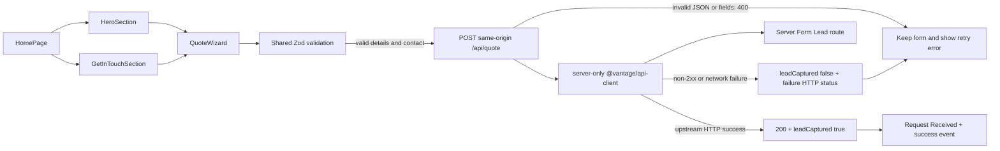

# Current route, UI and quote inventory

Source scope: current main `145a4dd`, identical runtime in Session 1 branch. Paths below are relative to `apps/main-site/src` unless qualified.

## Route map

| Current route or destination | Owner / behavior | Integration treatment |
|---|---|---|
| `/` | `app/page.tsx` → `HomePage`, streamed published testimonials | Production design control |
| `/#quote`, contact form | `HeroSection` → `QuoteWizard`; `GetInTouchSection` → separate panel wizard | One shared implementation, currently separate instance state |
| `/#services`, service anchors | `ServicesSection`, `ServicesDropdown`, `lib/content.ts` | Replace navigation destinations with reviewed canonical service pages; preserve legacy anchors |
| `/#map` | CoverageMap state selection and quote CTA | Add real state links and text directory; selected map state is reading interest |
| `/#about`, `/#faq`, `/#contact` | Home sections | Preserve deep links and new-visitor/booked-customer contact access |
| `/consumer-information` | `app/consumer-information/page.tsx` | Preserve broker/consumer and official resource access |
| `/carrier-contacts` | API-backed active carrier listing | Preserve; not a carrier application workflow |
| `/privacy`, `/terms`, `/cancellation`, `/sms-privacy`, `/sms-terms` | Current legal pages and shared policy components | Preserve English canonical documents until reviewed translations exist |
| `/privacy#dns`, `/accessibility` | Privacy opt-out destination; accessibility page | Keep reachable in footer |
| `/your-rights`, `/ready-to-move` | Redirect route handlers → local federal consumer PDFs | Preserve useful shortcuts and new-tab indication where used |
| `/sitemap.xml`, `/robots.txt` | Explicit route list; preview robots disallow all | Registry-generated reviewed entries later; no draft indexing |
| `/manifest.webmanifest`, `/icon.svg`, `/opengraph-image` | Next metadata endpoints | Preserve brand metadata |
| `/api/quote` | Validated Main Site Form Lead intake | Preserve server boundary and payload |
| `/api/places/autocomplete`, `/api/places/details` | Server-side Google auth | Current wizard calls autocomplete; details route exists but is not used by this wizard |
| `/services`, `/services/[slug]`, `/es/servicios/[slug]` | Absent on current main | Index new; selectively import localized details from service branch |
| `/locations`, state/city routes, `/resources`, articles | Absent | Build only from reviewed entries |
| Spanish home/index/legal, careers/applications, dedicated support/complaints | Absent | Do not manufacture destinations or imply translated pages exist |

Production's extracted links agree with the current hash/legal/contact surface. The build route table confirms current local routes. This inventory is not a live HTTP health check of every legal/PDF destination.

### Contact and navigation inventory

`lib/content.ts` owns `(888) 477-9232` / `tel:8884779232`, `support@vantagehomemovers.com`, hours and address. These are observed configured destinations, not fresh verification of recipients or operating hours. Header has Services, Locations, About Us, FAQs, Contact, phone and quote. Desktop navigation disappears below `lg`; there is no mobile menu. Dropdown opens on hover/focus; Escape closes, without explicit trigger-focus restoration. Touch/click behavior needs explicit design.

Footer service labels sometimes share targets: Residential and Interstate point to long-distance; Loading & Unloading points to packing. “Join Our Carrier Network” points to `/carrier-contacts`, which is a directory rather than intake. No dedicated careers recipient is established. Keep owned phone/email destinations until a responsible team confirms replacements. Legal and consumer information must remain direct links.

### Tokens, components and media

| Source | Current design control |
|---|---|
| `app/globals.css` | Blue `#024799`, bright blue `#1763cf`, yellow `#ffce45`, cream `#f6f1e8`, ink `#111827`, footer `#0b0d14`; 1200px max width; radii 7/9/11/13/16/20px; named card/menu/CTA shadows |
| `lib/fonts.ts` | Bricolage Grotesque display and Hanken Grotesk body; hero/nav/form use Red Hat Display + Manrope; testimonials use bundled Source Sans 3 |
| `HeroSection.tsx`, `lib/playground/*` | Promoted production presets: muted photo filter, blue overlay, high-contrast white text, yellow primary CTA, glass secondary CTA; keep resolver dependencies |
| `Header`, `SiteFooter` → `Footer`, `Logo`, `Container` | Existing recognizable shell; add destinations without replacing with the A Route shell |
| `CoverageMap`, `ServicesDropdown`, `HowItWorksSection` | Keep existing visuals; add navigable destinations and later accessible manual still-image process sequence |
| `lib/images.ts` | Central current photo registry; no rights/provenance ledger here |

Existing image slots: hero `/hero_image_enhanced.png` (1,833,644 source bytes; alternate `/hero_image.webp` 42,906); long-distance `/long_distance_traffic.webp` (401,084); packing `/couple_with_boxes.jpg` (50,028); office `/moving_boxes_in_office.webp` (12,024); military `/military_moves.webp` (16,280); about `/customer_service_rep.webp` (27,056); coordination `/customer_service_rep.png` (2,149,561); expertise `/sitepictures/Truck%20Loaded.jpeg`; auto `/sitepictures/autotransport.jpg`. Source bytes are not transferred Next-image bytes or LCP measurements. Record responsive delivery and layout shift in Session 5. Existing assets are candidates, not proof of rights, staff identity, Vantage-owned equipment or testimonial authenticity.

## Quote flow and failure contract

1. `HomePage` mounts two independent wizard instances. Hero defaults to `id="quote"`; contact uses panel configuration. `useForm` keeps hidden-step fields (`shouldUnregister:false`), while ZIP display, step, reference and LID are local React state. There is no cross-route/locale draft persistence.
2. Moving Details requires two five-digit ZIPs, today-or-future date and canonical `MOVE_SIZES`: Studio, 1 Bedroom, 2 Bedrooms, 3 Bedrooms, 4 Bedrooms, 5+ Bedrooms, Office. ZIP autocomplete is advisory: unmatched ZIPs or lookup failures retain a syntactically valid manual ZIP. No pickup geolocation or reviewed destination identity is present.
3. Contact requires name, email and at least ten phone digits. SMS consent defaults checked but is optional; unchecked is valid. Do not silently change this contract while integrating layouts. Field captions are standalone labels without explicit input association in `Field`; fix accessible names/error associations during form integration.
4. Final submit validates both steps, disables navigation while loading and posts current fields, Main Site attribution, `ref_no`, `lid`, and `sms_consent`. The internal `MS-…` reference is stable for the mounted form; inbound `ref_no` is appended with a 24-character limit. LID has `LID` + 13 lowercase hex digits. Failed requests retain both IDs and all entered values. Start Over changes LID, resets fields/step and retains the internal reference; the started-event guard is not reset. Do not assume backend exactly-once persistence from these client IDs alone.
5. `app/api/quote/route.ts` validates JSON and Zod again. Malformed/invalid input returns 400 without invoking the shared API client. It forces `main_site` / `vantagehomemovers.com` regardless of browser attribution; forwards name, email, phone_number, pickup_zip, destination_zip, move_size, move_date, optional ref_no, lid, `post_to_granot:true`, and consent. Explicit snake-case consent takes precedence over form camel-case consent.
6. `packages/api-client/src/index.ts` is the only backend seam (`server-only`). It applies secret and optional bypass headers server-side; POSTs JSON with `cache:no-store` to the configured Form Lead route. It reports HTTP success as `ok:true`; failed HTTP returns status/error; thrown/network/auth failure returns status 0. No browser backend secret, CORS change or new service attribution field is needed.
7. Quote route returns placeholder `low/high` plus `leadCaptured:true` on upstream success. On failure it returns `leadCaptured:false` and upstream failure status (or 502 for status 0). Placeholder estimate math is not tariff data, and current confirmation does not display the numbers. Backend persistence must still be proven by isolated Lead readback.
8. Wizard throws on non-2xx, emits `form_submit_failed`, stays on Contact and shows “Something went wrong…” with retry/call options. On any 2xx JSON, it moves to confirmation; `leadCaptured` chooses success vs failure event. **Latent edge:** a 200 with false/missing `leadCaptured` still says “Request Received” and emits `quote_estimate_viewed`. Current route avoids this for normal failures, but Session 3 should explicitly gate confirmation on `leadCaptured === true` and test malformed/false responses.

Local intercepted 503 → 200 trials at both widths verified field retention and identical retry payloads with unchecked consent. They did not test backend idempotence, preview writes or production persistence. Existing route tests mock the API client and establish attribution/status behavior only.

## Analytics inventory and integration gaps

Root layout mounts `SiteAnalytics`, Vercel `Analytics` and `SpeedInsights` once. `lib/analytics.ts` maintains session visit/engagement/intent/bounce flags. Wizard tracks step viewed/completed, first focus/change (`form_started`), date picker opened, field validation, submit attempted/succeeded/failed, and estimate viewed. It includes form name/version, form variant/id and limited move metadata. ZIP-not-recognized currently includes the ZIP itself; remove itinerary dimensions when reconciling the new nonpersonal measurement contract.

`SiteAnalytics` delegates phone, email, legal, explicit CTA and hash-navigation clicks. New real page links do not automatically get the old hash-nav event. Section observation is initialized once rather than on every route transition. There are no consistent app/environment/variation/page/service/locale dimensions across all events. The service branch adds service/locale to some wizard events, not all.

The current helper marks `phone_clicked` as converted for bounce purposes. That does not qualify a Call Lead, Booking or revenue. First focus can count as started even without changed input. A 2xx without capture also emits estimate-viewed intent. Session 7 must distinguish intentional form activity, confirmed capture and phone intent, avoid duplicates, prevent analytics errors from interrupting intake and verify destination receipts. This session blocked telemetry during browser captures and makes no delivery or conversion-rate claim.
